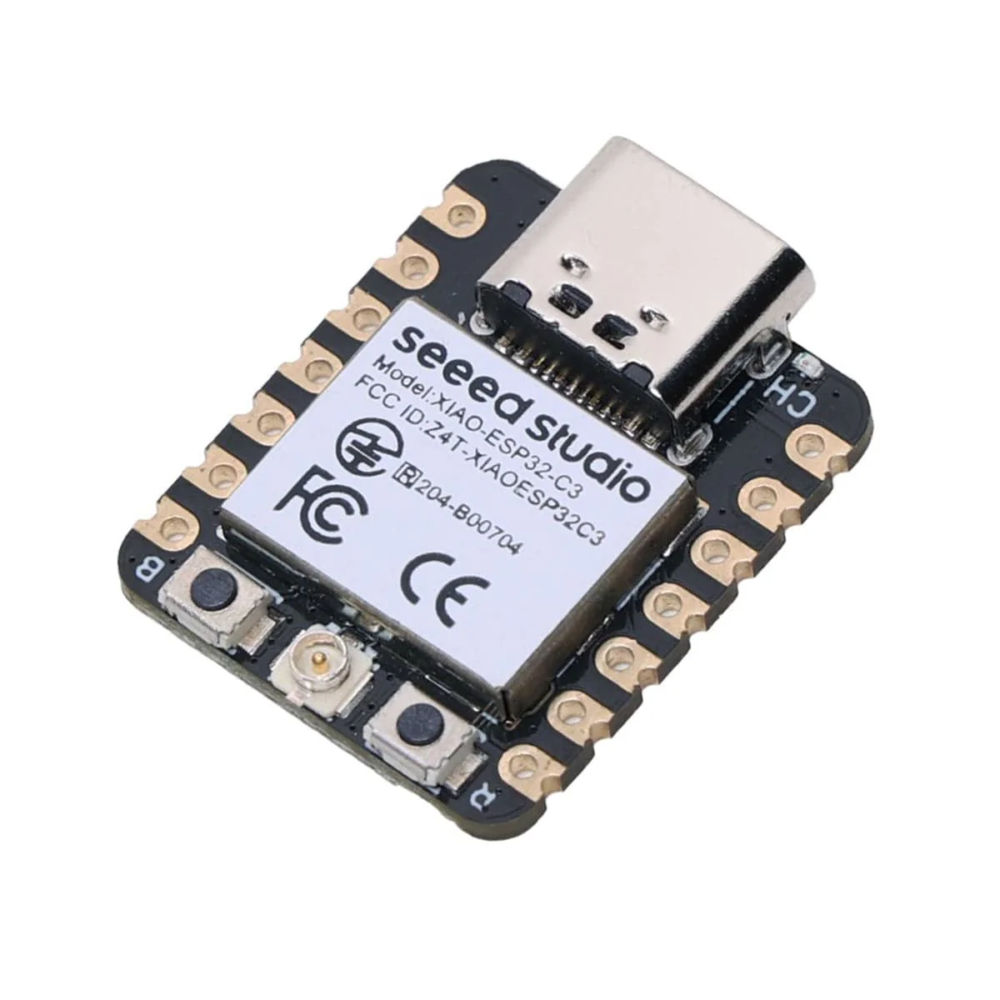
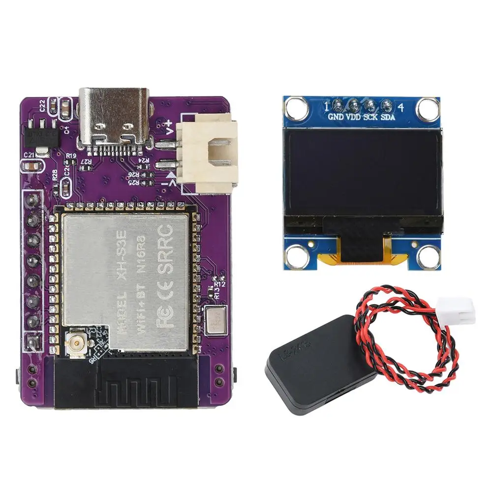

# ESPGeiger Compatible Hardware

ESPGeiger is written to be compatible with both the ESP8266 and ESP32 range of MCUs.

## ESP8266

The [Wemos D1 Mini](https://s.click.aliexpress.com/e/_DmfPg5L) (4MB) is the recommended ESP8266 MCU for ESPGeiger.

The ESP8266 ESPGeiger build is the base firmware for the official ESPGeiger-based hardware __ESPGeiger-HW__ and __ESPGeiger Log__.

## ESP32

### Classic

The **[ESP32 DevKit / WROOM-32](https://s.click.aliexpress.com/e/_c4MWYcBT)** (classic ESP32) is the recommended ESP32 target. Any 4 MB board built on the original ESP32 (Tensilica dual-core, IDF target `esp32`) should work with the `esp32_*` builds. ESP32 / ESP32-S3 / ESP32-C3 / ESP32-S2 builds bundle SSD1306 OLED support and auto-detect the panel at boot, so the same env works whether or not a display is fitted.

### ESP-S3

For ESP32-S3, the **[ESP32-S3-WROOM-1 N16R8](https://s.click.aliexpress.com/e/_c40rZstr)** dev board (44-pin Type-C, 16 MB flash, 8 MB PSRAM, onboard NeoPixel on GPIO 48) is a target for the `esp32s3_*` builds.

### ESP-S2

S2 boards with native USB and 4 MB flash, like the **[Lolin S2 Mini](https://s.click.aliexpress.com/e/_c388T7W1)** (Wemos D1 Mini footprint) and **S2 Pico**, take the `esp32s2_*` builds. The first flash needs the board in download mode by hand: hold **0**, tap **RST**, let go of **0**, then press **RST** once the flash is done. After that, updates go over the web as on any other board.

### ESP-C3

For a small ESPGeiger, the **[Seeed Studio XIAO ESP32-C3](https://s.click.aliexpress.com/e/_c3OtwhXJ)** (21x17.5 mm, USB-C, BLE 5.0, external u.FL antenna) takes the `esp32c3_*` builds. With power and a tube or a UDP feed it is a working monitor that fits in most enclosures.
 

Other variants and devboards for the ESP classic, C3, S2 and S3 should all be supported. Most options are selectable runtime for various pins, OLED options, NeoPixel and LED.

### Variant support

| Variant | Status | Notes |
|---|---|---|
| **ESP32 (classic)** | Fully supported | All `esp32_*` build envs. PCNT hardware counter. SSD1306 OLED bundled and auto-detected. |
| **ESP32-S3** | Supported | Generic `esp32s3_pulse / _pulse_no_pcnt / _serial / _udp / _test` envs. As on ESP32 classic, `_pulse` uses the PCNT hardware counter and `_pulse_no_pcnt` uses the interrupt counter. SSD1306 OLED bundled and auto-detected. |
| **ESP32-C3** | Supported | `esp32c3_*` envs (RISC-V, no PCNT - software pulse counter). SSD1306 OLED bundled with default SDA=5 / SCL=6. |
| **ESP32-S2** | Supported | Generic `esp32s2_pulse / _serial / _udp / _test` envs for S2 boards with native USB and 4 MB flash (Lolin S2 Mini, S2 Pico). Console and Improv on the native USB port. `_pulse` counts with PCNT, or the interrupt counter from the Input tab. SSD1306 OLED bundled, SDA=8 / SCL=9. |
| **ESP32-C6 / H2** | Not supported | No build envs. RISC-V cores not tested. |

### Boards with onboard OLED

Several popular ESP32 / ESP8266 boards ship with an SSD1306 OLED soldered to the same PCB. ESP32 family envs bundle OLED support and auto-detect the panel; set SDA / SCL in the **I2C Bus** section (and the Display **Reset pin** if your board wires it) on the Config page after flashing. ESP8266 still uses dedicated `esp8266oled_*` builds.

| Board | MCU | OLED pins (SDA / SCL) | OLED RST | Build | Notes |
|---|---|---|---|---|---|
| **[NodeMCU + 0.96" OLED](https://s.click.aliexpress.com/e/_c3q9xiwZ)** | ESP8266 | 4 / 5 (default) | tied to 3V3 | `esp8266oled_*` | Works out of the box - matches firmware defaults. |
| **Heltec WiFi Kit 32 V2** | ESP32 classic | 4 / 15 | GPIO 16 | `esp32_*` | Set SDA=4 / SCL=15 / RST=16 from Config page after flashing. |
| **Heltec WiFi LoRa 32 V3** | ESP32-S3 | 17 / 18 | GPIO 21 | `esp32s3_*` | Set SDA=17 / SCL=18 / RST=21 from Config page after flashing. |
| **TTGO LoRa32 V1** | ESP32 classic | 4 / 15 | GPIO 16 | `esp32_*` | Same recipe as Heltec V2. |
| **LilyGo T-Beam** | ESP32 classic | 21 / 22 | none | `esp32_*` | Set SDA=21 / SCL=22 from the Config page after flashing (firmware default is 4 / 5). |
| **[MINI ESP32-S3-N16R8](https://s.click.aliexpress.com/e/_c3dXGAQt)** (sold as "XH-S3E-AI"; small purple board, onboard speaker + mic + button + NeoPixel + OLED header)   | ESP32-S3 (16 MB flash, 8 MB PSRAM) | 41 / 42 (fixed) | none | `xh_s3e_*` | Dedicated env set; board pins fixed in build flags, counter RX/TX still settable. See [buildtargets](/install/buildtargets#audio-tick-esp32-s3-only). |

Boards that wire the OLED's reset line to a GPIO (Heltec / TTGO) need that pin pulsed at boot. Set **Config > Display > Reset pin** (advanced) to the GPIO and restart; 255 means none. Custom builds can preset it with `-DOLED_RST=N`.

If your board isn't listed but matches one of these patterns, the same recipe applies - set `OLED_SDA`, `OLED_SCL` and `OLED_RST` (if relevant) in a custom build env.

### PCNT

The `ESP32` range of MCUs feature an in-built [hardware pulse counter](https://docs.espressif.com/projects/esp-idf/en/v5.4/esp32/api-reference/peripherals/pcnt.html) (`PCNT`). The ESP32, ESP32-S2 and ESP32-S3 `_pulse` builds carry both counters: **Count with** in the Input tab's advanced settings (`counter.count_mode`) picks Hardware (PCNT, the default) or Interrupt, the same interrupt counter as the ESP8266 builds, and applies after a restart. The PCNT filter and PCNT pull settings show for Hardware, Debounce for Interrupt. The `_no_pcnt` builds are the same firmware defaulting to Interrupt; they are retired in 0.15, and a `_no_pcnt` device flashed with the `_pulse` build keeps counting by interrupt if it ran the 0.14 `_no_pcnt` build first. Straight from 0.13 it starts on Hardware: set **Count with** to Interrupt. The [Web Installer](/install/webinstall)'s Pulse option installs the `_pulse` build. The S2 has no `_no_pcnt` build. ESP32-C3 has no PCNT and always uses the interrupt counter.

Hardware is the better choice at high count rates: it has no dead time of its own, while the interrupt counter's debounce (below) drops pulses that come close together.

The PCNT input pin floats by default (None), as an internal pull-up can hold some modules' output high so no pulse gets through (the Cajoe IOT-GM v1.1, for one). Change **PCNT pull** in the Input tab's advanced settings to Pull-up for open-drain outputs, or Pull-down for active-high modules with no idle pull of their own.

### PCNT Filter

The PCNT hardware includes a glitch filter that can ignore pulses shorter than a configurable threshold. This helps filter out electrical noise and interference that could otherwise be counted as false radiation events.

The filter value can be configured from the ESPGeiger web interface under __Config__. The value ranges from 0 to 1023, representing APB clock cycles at 80MHz (each unit = 12.5ns). A value of 0 disables filtering.

| Filter Value | Pulse Duration Filtered | Use Case |
|---|---|---|
| 0 | Disabled | No filtering |
| 200 (default) | < 2.5µs | Filters electrical noise while passing all real geiger pulses |
| 500 | < 6.25µs | More aggressive filtering for noisy environments |
| 1023 | < 12.8µs | Maximum filtering |

Real Geiger-Muller tube pulses are typically 50-200µs in duration, so even the maximum filter value will not affect real readings. The filter only applies when an ESP32 counts with Hardware (PCNT).

Custom builds can change the starting value. See [Build Options](/dev/platformio#esp32-hardware-counter-pcnt).

### Interrupt Debounce

On builds that use software interrupt counting instead of PCNT (all ESP8266 and ESP32-C3 pulse builds, and ESP32, S2 and S3 builds set to **Count with** Interrupt), a debounce window rejects any edge that arrives within a configurable number of microseconds of the previously accepted pulse. This serves the same purpose as the PCNT filter - suppressing electrical noise and contact bounce without affecting real tube pulses.

The debounce value can be configured from the ESPGeiger web interface under __Config__. The value is in microseconds, with a range of 0 to 10000. A value of 0 disables the debounce.

| Debounce Value | Pulses Rejected | Use Case |
|---|---|---|
| 0 | Disabled | No debounce |
| 200 (default) | < 200µs apart | Suppresses typical switching noise, passes all real pulses |
| 1000 | < 1ms apart | More aggressive for noisier setups |

Real Geiger-Muller tube dead time is around 50-200µs, so the default sits just below the tube's own recovery time and passes real events at normal rates. At high rates it adds a dead time of its own (at 400 counts a second the 200µs default drops about 7%); the [dead time](/configuration/counter#tube-dead-time) correction uses the debounce when it is the longer of the two, so the reading allows for it. The debounce only applies to the software interrupt path; counting with PCNT uses the PCNT Filter above instead.

Custom builds can change the default. See [Build Options](/dev/platformio#geiger-counter-input).

### Interrupt Saturation Guard

On interrupt-counting builds, an input flooded with far more edges than any tube can produce is paused, for <!-- gen:const ISR_STORM_COOLDOWN_S s -->5 seconds<!-- /gen --> at first and up to <!-- gen:const ISR_STORM_MAX_S s -->5 minutes<!-- /gen --> while it goes on. The rest of the device keeps running. The log shows `ISR storm`. See [Troubleshooting](/troubleshooting#log-shows-isr-storm) for causes.
