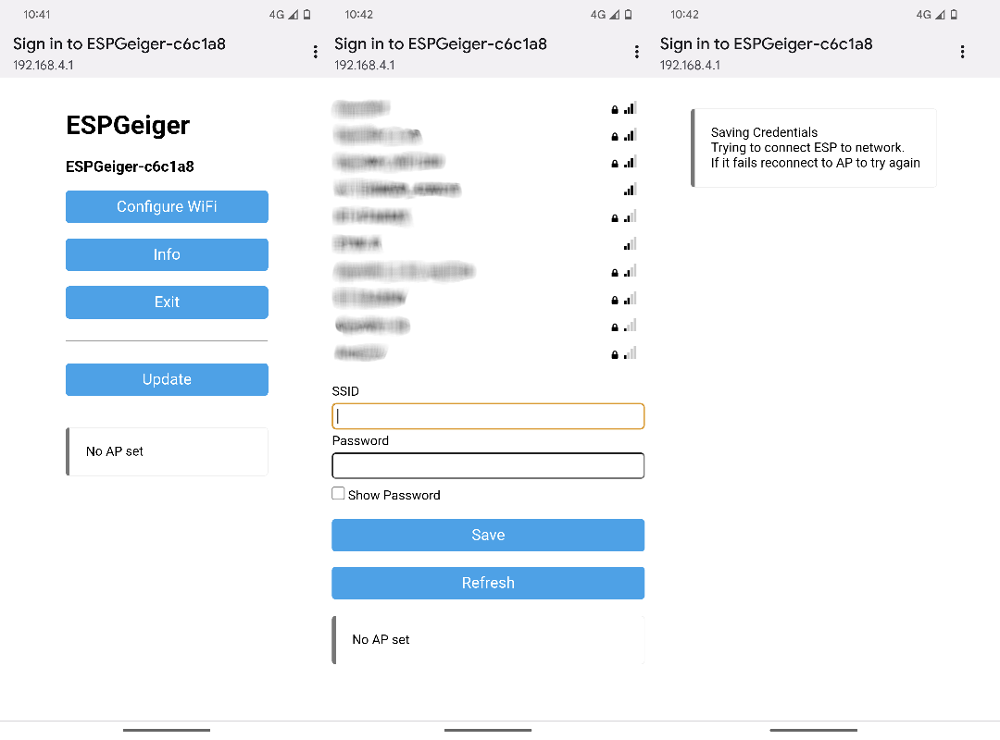

# Initial Setup



After first installation ESPGeiger requires configuring for connection to a WiFi network.

The ESPGeiger opens a setup portal, its own WiFi network, which allows the user to configure which WiFi network the ESPGeiger connects to. The setup portal has no WiFi password, so anyone nearby can join it while it is up. With a web password set, its pages still ask for it.

Connecting to the setup portal should automatically show a configuration page.

Visiting [http://192.168.4.1/](http://192.168.4.1/) whilst connected to the setup portal will also show the configuration page.

> **Captive portal not appearing?** The automatic popup relies on DHCP-assigned DNS. If your device has a manual DNS server set (e.g. a pinned `1.1.1.1` or a local LAN DNS), the captive-portal detection probe fails silently because the DNS server isn't reachable from the ESPGeiger AP. Either switch that interface to DHCP-assigned DNS, or just browse to [http://192.168.4.1/](http://192.168.4.1/) directly - both work.

To configure ESPGeiger for WiFi:

- Once connected, make a note of your ESPGeiger's ID - __ESPGeiger-XXXXXX__ this will be used to connect to the web interface.
- The page shows the network form straight away.
- Select your Wifi Access Point from the list shown, OR
- Enter your SSID in the form area provided
- Enter your password in the form area provided (8-63 characters or a 64 hex digit key, or leave it blank for an open network)
- Click Save

The device then saves the network and restarts to join it. If it can't, the setup portal comes back with a **Last try** line that says why: the network wasn't found, the password was refused, the network refused the connection, or no reply. Fix it there and save again.

You should now be able to browse to the ESPGeiger web interface to finish setup.

The ESPGeiger will be available on [http://ESPGeiger-XXXXXX.local](http://ESPGeiger-XXXXXX.local) - an alternate is to find the DHCP address given to the ESPGeiger in your routers web interface.

### Setup portal and the web password

If a web password is set, the setup portal asks for it too: user `admin`, password the web password. A new device has none, so this only shows up on a device that has dropped back to the setup portal, for example after a router change. Forgotten it? See below.

## Locked out of the web UI?

If you set a web password (Config &rarr; System &rarr; Web password) and have forgotten it, the device's main web pages and the setup portal will keep prompting you for credentials. The password is stored on the device, not in the cloud, so there is no remote reset. There are four ways to recover, in order of least to most disruptive:

### 1. Clear via the USB serial console

Connect the device over USB to your computer and open a serial terminal at **115200 baud**. Type:

```
set sys.web_pass
```

(That is, the `set` command with an empty value.) The web UI stops prompting on the next request. The console also says `Restart to apply`: that is for [espota](/install/ota#via-espotapy-arduinoota), which only reads the password at boot.

To set a new password later: `set sys.web_pass MyNewPassword` (<!-- gen:const WEB_PASS_MIN -->8<!-- /gen --> or more characters).

This works with the setup portal up too, with a restart (`reboot`) after the `set`: the portal reads the password once, when it starts. During the portal the console takes `set`, `get`, `reset`, `resetwifi`, `resetnet`, `offline`, `ver`, `safe` and `reboot`. ESPGeiger Log builds don't read serial commands at all.

The web password is also kept outside the settings files, so a device that loses its settings (a damaged or reformatted file system) comes back with the same password, and **Info** shows *Web password: restored from backup (settings lost)*. A factory reset or clearing the password as above clears that copy too.

### 2. Set the WiFi over USB

If the device is stuck on the setup portal, open [install.espgeiger.com](https://install.espgeiger.com) in Chrome or Edge, click Connect and pick the device, then choose the option to change or connect Wi-Fi (no reinstall needed). This sets the WiFi without going through the portal or the password. The web pages still ask for the password afterwards, so then clear it with option 1.

This doesn't work on ESPGeiger Log, where the serial RX pin is the push button. Use option 3 there.

### 3. Hardware button factory reset

On builds with a push button (such as ESPGeiger-HW and ESPGeiger Log):

1. Power off the device.
2. **Hold the push button.**
3. Power on while still holding.
4. Keep holding for **at least 5 seconds** (the display counts down; on ESP8266 builds the status LED blinks once a second), then release. Don't hold it for 30 seconds or more: that is taken as a stuck button and the device boots as normal.

On a plain ESP32, S2, S3 or C3 dev board the push button is the board's own **BOOT** button. Held while powering on, BOOT starts the chip's download mode and ESPGeiger never runs, so power on first and press BOOT **a moment after**, then keep holding. The serial console shows `BOOT: button held` once it has been seen; if nothing happens, power-cycle and press a little later.

The device performs a factory reset, wiping all settings including the web password and the WiFi credentials. Your ESPGeiger Stations identity and the lifetime totals (clicks, first boot, tracked time) are kept; **Reset lifetime** on the [History page](/output/history) clears the clicks and tracked time. Re-run [Initial Setup](#initial-setup) from the top of this page. Releasing the button before <!-- gen:const CORIUM_BOOT_BUTTON_RESET_S s -->5 seconds<!-- /gen --> starts [Offline Mode](/configuration/offlinemode) instead.

### 4. Reflash via the Web Installer

Nuclear option: reflash the firmware from [install.espgeiger.com](https://install.espgeiger.com) and tick **Erase device**. This wipes everything (web password, WiFi credentials, all output configurations). Re-run Initial Setup afterwards.

## Network and security

ESPGeiger is designed to run on your **local network**, not on the open internet.

The web interface uses HTTP Basic Auth with no TLS. With a web password set, `/update` and espota (when **Arduino OTA** is on) take new firmware from anyone who has it; with no password, from anyone on your network. Firmware images are not signed. The web login stops for <!-- gen:const EGHTTP_BRAKE_MS ms -->10 seconds<!-- /gen --> after <!-- gen:const EGHTTP_BRAKE_TRIES -->5<!-- /gen --> wrong passwords (the [login brake](/configuration#login-brake)); espota has no brake. None of that is a problem on a trusted LAN. **It is a problem on a port-forwarded WAN address.**

If you need to reach your device from outside your LAN, use one of:

- **VPN** into your home network (WireGuard, Tailscale, ZeroTier, OpenVPN on your router).
- **SSH tunnel** from a trusted jump host.
- **Reverse proxy** (Nginx, Caddy) that terminates TLS and adds rate limiting in front of the device.

Do **not** port-forward the device's HTTP port directly to the internet.

What the device doesn't do:

- No TLS: the password and pages cross your network in clear.
- No update check: it doesn't tell you a new release is out.
- No check on NTP replies: it takes the time it is given.
- Anyone with the device in hand can reflash it and read what is stored on it.
- WiFi and service passwords stay on the device until a factory reset or an erase, so clear it before you give it away. A factory reset keeps the station key. **Reset key** under Advanced on the `/webapi` page clears it, as does a Web Installer erase, so the next owner doesn't post as your station.

### Remote monitoring done right

To share readings without exposing the device, let it push data **out**: [MQTT](/output/mqtt) to your own broker, a [Webhook](/output/webhook), or public services such as [Radmon](/output/radmon), [GMC](/output/gmc), [ThingSpeak](/output/thingspeak) and [ESPGeiger Stations](/output/webapi). None of these need inbound access.
