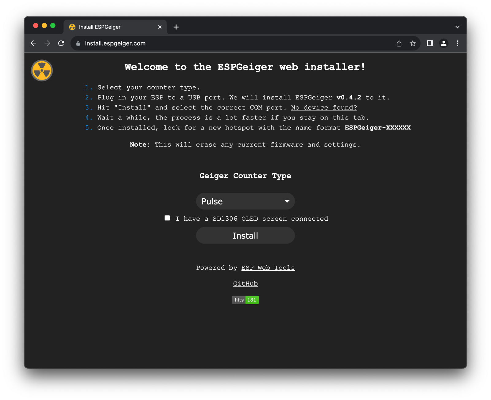
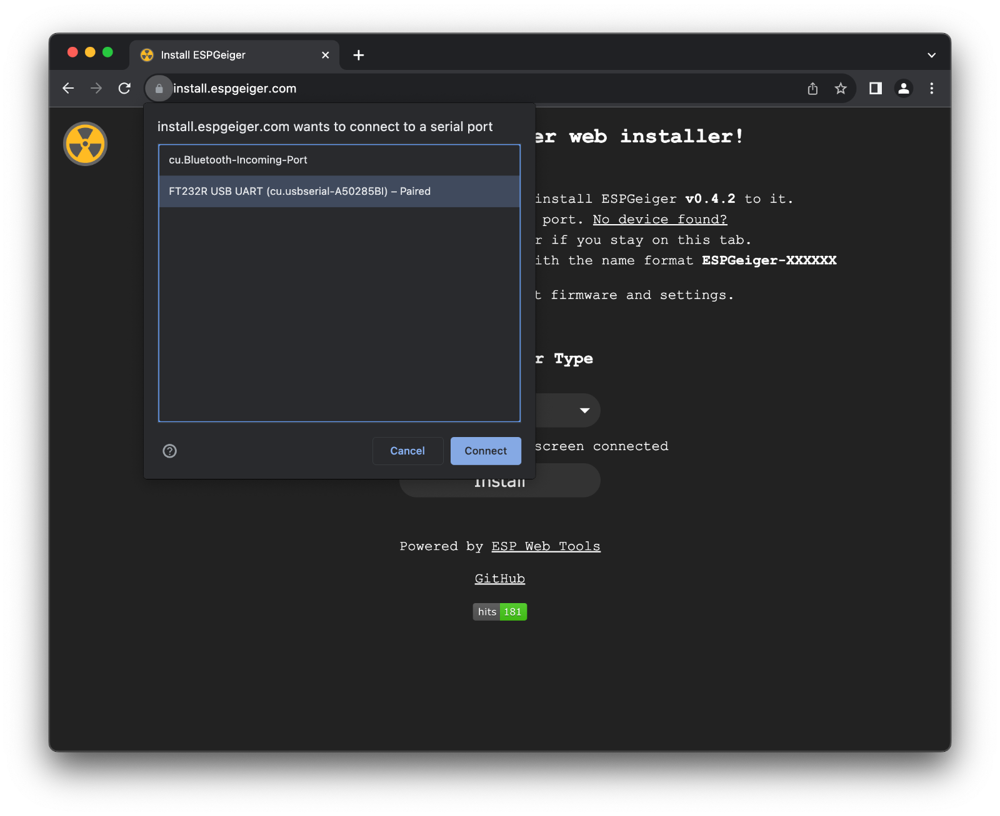
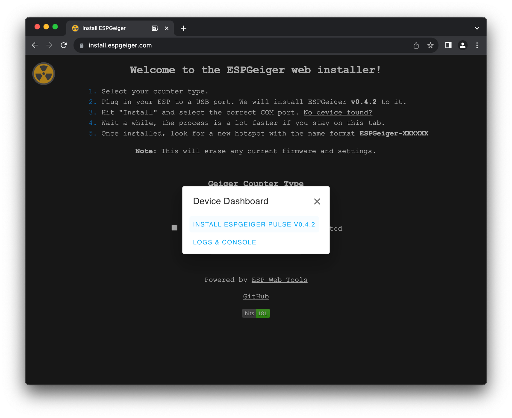
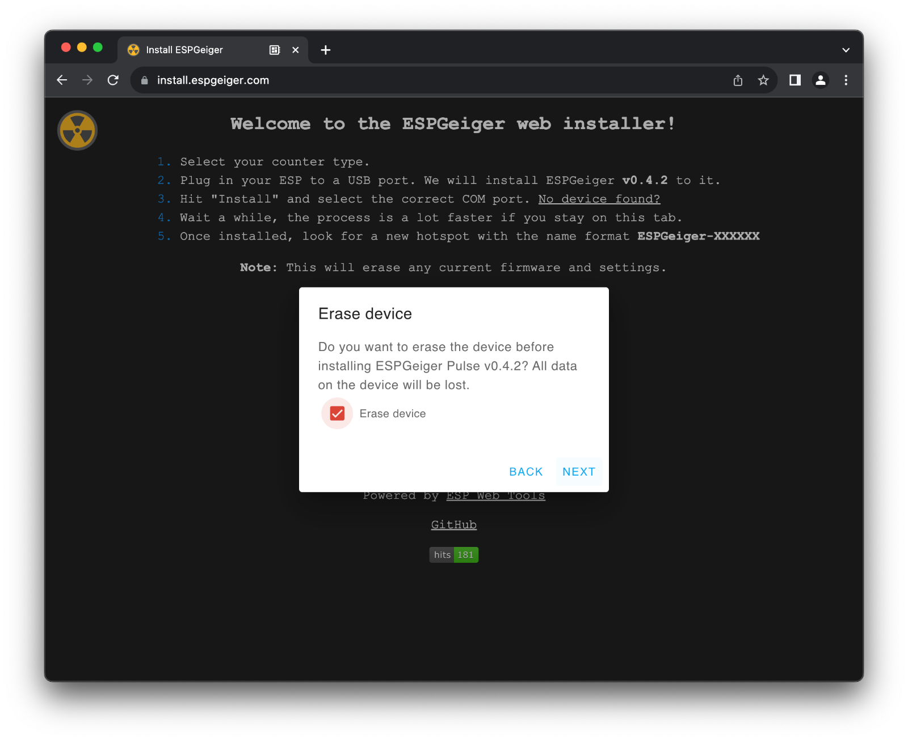
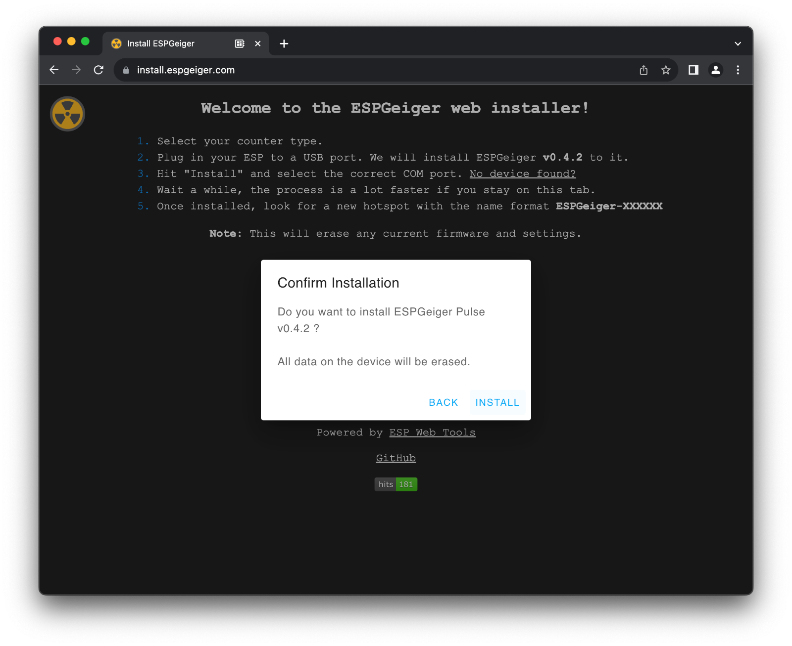
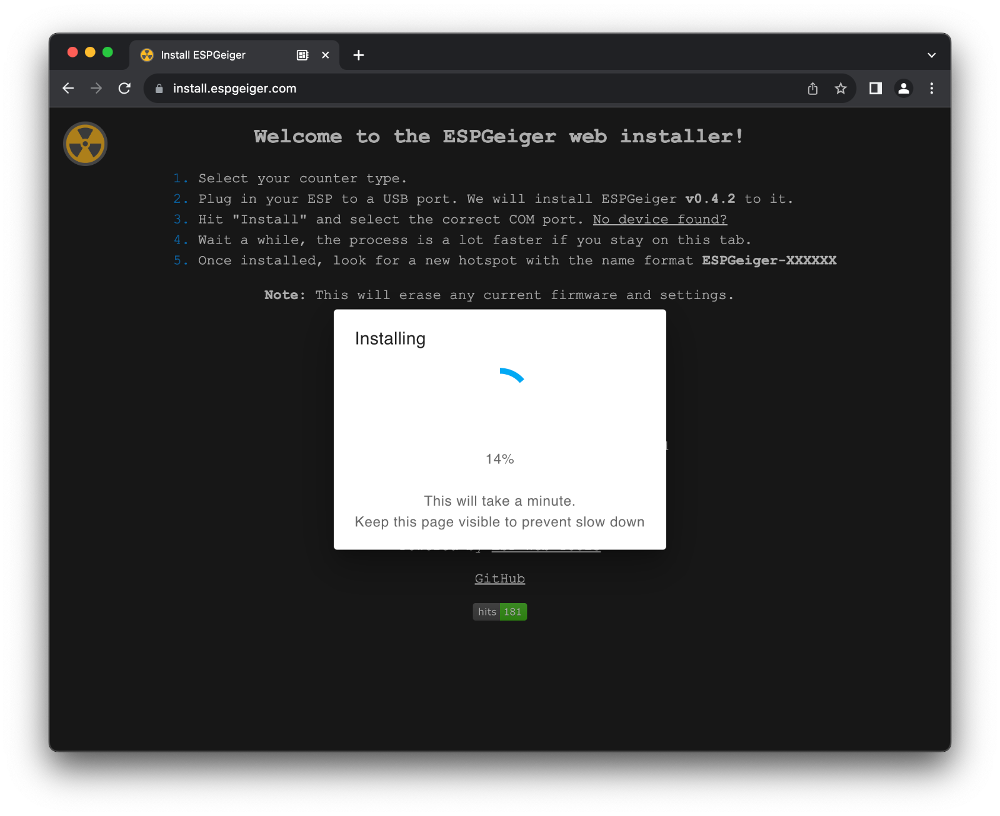
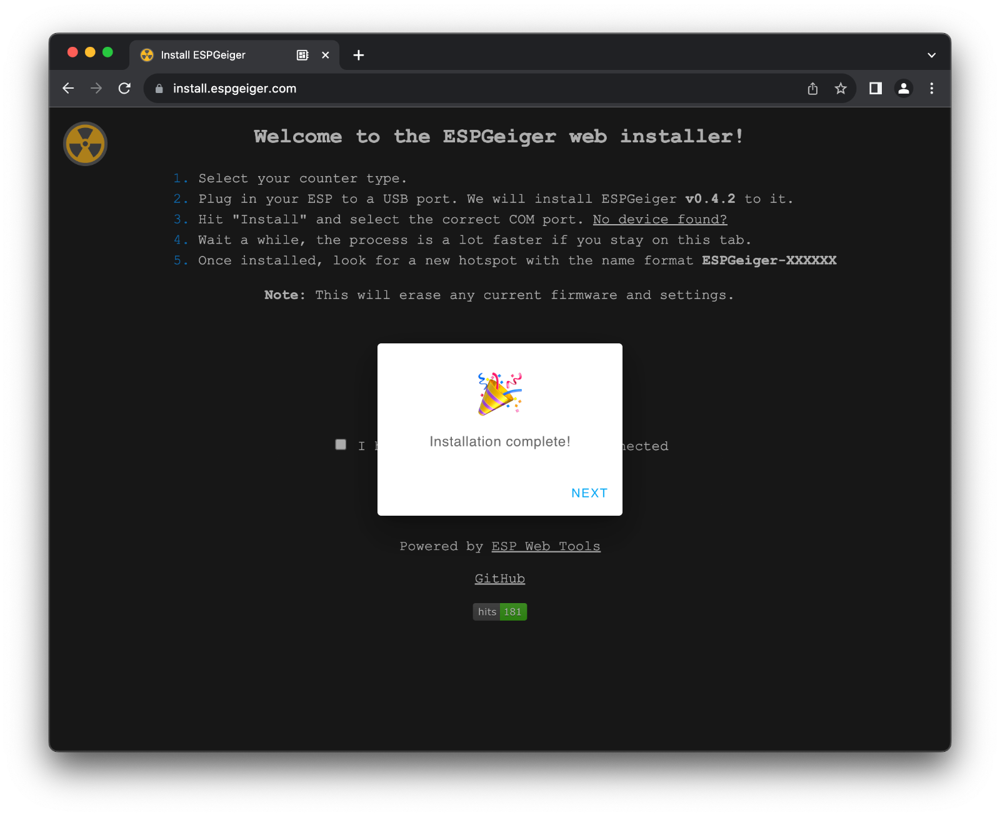

# Web Installer

The web installer at [https://install.espgeiger.com/](https://install.espgeiger.com/) is the quickest way to install ESPGeiger.

From the Web installer a number of predefined builds can be installed -

## Pulse

The installer picks the right binary for the chip family connected (ESP8266 / ESP32 / ESP32-S2 / ESP32-S3 / ESP32-C3).

On ESP32, ESP32-S2 and ESP32-S3 the Pulse build carries both counters: Hardware (PCNT, the default) and Interrupt. **Count with** on the Config page's Input tab switches between them without a reflash (restart to apply). If counts look low or noisy on Hardware, try Interrupt. ESP8266 and ESP32-C3 count by interrupt.

## Serial

A single unified serial build supports all serial counter types. After flashing, select your counter type (GC10, GC10Next, MightyOhm, ESPGeiger or Template) from the **Config** page. ESP8266, ESP32, ESP32-S3, ESP32-C3 and ESP32-S2 are all detected automatically.

- Serial

## Hardware

Builds for specific Geiger Counter models and other hardware projects

- ESPGeiger-HW
- CAJOE-IOT GM

## ESPGeiger Log

Firmware versions for the ESPGeiger Log, providing Pulse and Serial variants.

- Pulse
- Serial

## Test

Features a number of test builds for various devices.

# Installation

The installation process is powered by [ESP Web Tools](https://esphome.github.io/esp-web-tools/)

The web installer requires the PC/Mac version of either Chrome or Edge.

Make sure the relevant drivers are installed for your device. If your device isn't detected, the installer page offers some guidance.

- Select the relevant __Geiger Counter Type__ you wish to install firmware for and where available, if the OLED variant should be used.

- Connect your ESP device to your PC. An ESP32-S2 goes into download mode by hand for its first flash: hold **0**, tap **RST**, let go of **0**.

- Click __Install__

- Confirm the version to be installed

- If this is the first install it is recommended to erase the device as well. This will remove any settings.

- Confirm options

- Await the install, this can take several minutes

- Completed. ESPGeiger is now installed. The ESPGeiger-XXXXXX network appearing is the sign the install worked.

- To skip the setup portal, use the installer's option to connect to Wi-Fi when it offers it. It sends your network details to the device over USB. This doesn't work on ESPGeiger Log, which uses the serial RX pin for its button; use the setup portal there. Otherwise carry on with [Setup](/install/setup).
