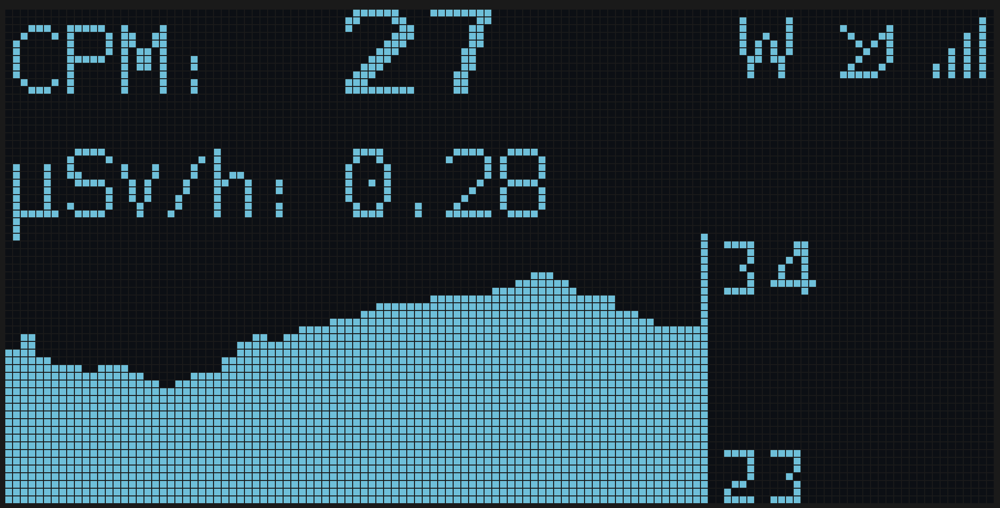

# OLED Display Output

# Display behaviour

Three settings in the **Display** section of the [Config page](/configuration#display-settings-oled-builds) control when the OLED is on:

- **Timeout** *(push-button builds only)* - seconds of inactivity before the display turns off after a tap. `0` falls back to the On/Off Time schedule below.
- **On Time / Off Time** - daily schedule; outside the window the display is off. Leave both blank for "always on". Window crosses midnight if `from > to` (e.g. `22:00`-`07:00`).
- **Brightness** - 0-100 %.

On builds **without** a push button, only the schedule applies.

On builds **with** a push button, the resolution order is:

1. Long-press override active → display always on.
2. Otherwise, if Timeout > 0 → on for Timeout seconds after each tap.
3. Otherwise (Timeout = 0) → follow On/Off Time schedule, with a 30-second wake window after any tap so you can check readings during off-hours.

# Push-button operations

## Single press

Cycles through the information pages. If the display is off, the first tap turns it on and shows page 1.

## Long press

Toggles the always-on override. Long-press once to keep the display on; long-press again to return to the Timeout and schedule.

The screen shows **Screen always on** or **Screen auto off** for a moment. The status LED gives one long pulse for always on, two short blinks for auto off.

# Pin configuration

Set **I2C SDA Pin** and **I2C SCL Pin** on the Display section of the Config page, then reboot. Not shown on kits with fixed pins.

# Browser screen viewer

Open **`/screen`** to see a live copy of the display in your browser, with a button for virtual taps. It works with no display attached, so a headless OLED build still shows what the panel would.

| Path | Returns | Use |
|---|---|---|
| `/screen` | HTML viewer page | Interactive view in the browser |
| `/screen.bin` | Raw framebuffer | Scripting (column-packed, 1 bit per pixel) |
| `/screen.bmp` | Monochrome BMP image | One-shot screenshot |
| `/screen/tap` | `OK` | Virtual short press of the user button (push-button builds) |
