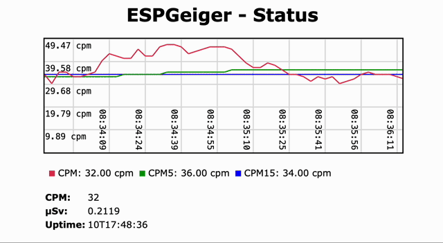

# Web Portal

ESPGeiger comes with a built-in Web Portal that lets you configure your device and view the live readings and status output from your laptop or mobile device.



## Configuring your device

The main page has buttons to reach each area of configuration:

* **Config** - all general device and output settings. See the [Configuration reference](/configuration) for the full list of options, value ranges and defaults.
* **Network Config** - Wi-Fi, static IP, time zone and NTP server. See [/network page](#network-page) and [Time and NTP](/configuration/ntp).
* **HV Config** - high-voltage tuning on ESPGeiger-HW and the `*_hv` builds. See [HV Configuration](/configuration/hv).

## Live blip indicator on `/status`

The coloured dot next to the CPM reading on the `/status` page is a synchronised mirror of the [NeoPixel output](/output/neopixel) - it flashes at a rate proportional to the CPM-vs-CPM5 ratio and changes colour based on a Poisson z-score against the 5-minute baseline. See the [NeoPixel page](/output/neopixel#how-the-trend-colour-and-flash-rate-are-derived-modes-3-and-4) for the colour table and full derivation.

It's an "activity trend" indicator rather than a per-click visualization. For per-click visual feedback, see the blip LED on supported builds. On the page the dot flashes at most 3 times a second, in colour-blind safe shades of the same colours. On the graph CPM5 and CPM15 are dashed.

While CPM is over the warning or alert level, `/status` shows "Warning level reached" or "Alert level reached" under the graph. Screen readers announce it once, when the level changes.

If the device stops replying, `/status` shows "Not updating - no reply from the device." and the dot and the browser clicks stop until it answers again. `/hv` shows "(not updating)" next to the target.

## Console log

The Status page includes a live console tail of the device's log. Timestamps follow two formats:

* `HH:MM:SS` - wall-clock time (device has synced to NTP and applied its configured timezone). The web UI converts these to your browser's local timezone so they line up with the graph.
* `HH:MM:SS*` - uptime since boot. The trailing asterisk signals that NTP hasn't synced yet; the time is not wall-clock and the browser should not timezone-shift it. Once NTP syncs, new lines appear without the asterisk.

In [offline mode](/configuration/offlinemode) there is no wall-clock and no asterisk - timestamps are plain uptime. The web portal itself isn't reachable when WiFi is disabled, but the same format appears on the serial console.

## HTTP endpoints

The ESPGeiger web portal exposes a number of HTTP endpoints that are useful for integration, scripting, or simply linking to directly from a browser.

| Path | Description |
|---|---|
| `/` | Main home page |
| `/status` | Detailed device status page (live readings, uptime, build info) |
| `/hist` | Rolling 24 h click history, lifetime totals and inter pulse interval histogram - see [History page](/output/history) |
| `/clicks` | JSON feed of the 24 h hourly bucket array plus today/yesterday totals and (when enabled) the lifetime block `{clk, fbt, secs}` - powers `/hist`. `secs` = tracked seconds (CPM denominator, advances only over persisted spans); `fbt` = first-boot epoch (install age). |
| `/json` | Machine-readable status snapshot - see [JSON Endpoint](/output/integrations#json-endpoint) |
| `/lastdata` | GeigerLog-compatible CSV line - see [GeigerLog](/output/integrations#geigerlog) |
| `/info` | Human-readable HTML page with full device + network identity - see [/info page](#info-page) |
| `/about` | Build, hardware and module identity, as JSON (useful for support) |
| `/network` | WiFi + static IP + NTP configuration - see [/network page](#network-page) |
| `/outputs` | Whether each enabled upload service is working, as JSON |
| `/hv` | High-voltage tuning page (ESPGeiger-HW and `*_hv` builds) |
| `/cpm?v=N` | Set target CPM on test geiger builds - see [Test build CPM setter](#test-build-cpm-setter) |
| `/screen` | Live display preview (OLED and MAX7219/TM1637 builds) - see [OLED](/output/oled#browser-screen-viewer) |
| `/export` | Streaming base64+CRC32 dump of the prefs that differ from their defaults. Device-only prefs are skipped: `sys.web_pass`, `sys.cpu_mhz`, the `net` group, the hidden `wifi.*` tunables and the lifetime totals. UI lives on the Config page's Backup tab. A 409 naming the group while a stored pref in an exported group didn't load. |
| `/import` (POST) | Apply a previously-exported blob. Every pref except the device-only ones goes back to its default first, so keys not in the blob end up at their defaults. Restarts on success. Refused while a stored pref in an exported group didn't load. |
| `/life/reset` (POST) | Zero the lifetime clicks and tracked seconds; the first-boot timestamp stays. Button on `/hist`. |
| `/erase` (POST) | Wipe saved WiFi credentials, clear the `net` group (DHCP, as `resetnet`) and restart into the setup portal. Linked from `/network` > Advanced > Erase WiFi. |
| `/reset` (POST) | Factory reset. Every setting back to its default, WiFi credentials and the web password copy cleared; the lifetime totals and the station key are kept. Restarts into the setup portal. Button: `/network` > Advanced > Factory reset. |
| `/restart` | Restarts the device - use with care |

For the `/json` response schema and examples of integrating `/json` or `/lastdata` with external tools (GeigerLog, Home Assistant, Prometheus, InfluxDB, Node-RED, Grafana), see [Integrations](/output/integrations).

The `/outputs` and `/about` response formats are on the [HTTP endpoint schemas](/dev/http-endpoints) developer page.

### `/info` page

Human-readable HTML report grouped into expandable sections. Useful as the first stop when raising a support issue or debugging odd behaviour.

| Section | Contents |
|---|---|
| System | Uptime, where the time came from (NTP, an RTC chip, kept over a restart, or not set), chip ID, free memory, firmware size and the room for it, restart reason. After a crash it adds the exception cause, PC and fault address, the extra registers and the saved stack: on ESP8266 only the code addresses in it, on ESP32 the backtrace, on ESP32-C3 the raw stack (with mcause and mtval); on both ESP32s a Crashed in row names the module that was running. Rows that only matter when something's wrong show only then: safe mode, crash boots in a row, a flash size that doesn't match the chip, a web password restored from backup. |
| WiFi | Network and channel, signal (RSSI in dBm, with excellent / good / fair / weak), IP, hostname, MAC, DNS. The hotspot's SSID, IP and MAC while it's running. |
| About | One build line (version, git hash, build environment, build date), Geiger model. |

The chip, flash, core/SDK and WiFi radio details, gateway, subnet, feature flags and the module list are in `/about`.

For machine-readable equivalents see `/json` (live data) and `/about` (static identity).

### `/network` page

WiFi + IP + NTP configuration, all on a single page. Reachable from the home page or directly via `/network`.

| Setting | Notes |
|---|---|
| **Network** dropdown | Live-scanned list of nearby SSIDs. The **Rescan** button re-runs a fresh scan. |
| **SSID** | Manual SSID entry. Blank keeps the current network and its password (useful when only changing the IP settings). To change the password, enter the SSID again. |
| **Password** | WPA2 password, 8-63 characters or a 64 hex digit key. Blank for open networks. Anything else is refused with an error. |
| **Use static IP** | Toggle under **Network (advanced)**. When unchecked the device gets its address by DHCP. When checked the four IP fields below take effect after a restart. |
| **IP address / Gateway / Subnet mask** | IPv4 fields with client-side validation. Server re-validates at boot; invalid combinations fall back to DHCP. On the first boot after a change the device also checks it can look up the NTP server name (the default NTP host if the NTP server is an IP address). If that fails it puts the previous IP settings back and restarts. |
| **DNS server** | Optional. If blank, the gateway is used. |
| **Time / NTP** | Lazy-loaded section: timezone picker (with a **Detect** button that takes your browser's timezone) and NTP server. Pulls a ~4 KB JS payload only when expanded. |
| **Erase WiFi** | Under **Advanced**. Wipes saved credentials and the static IP settings, and restarts into the setup portal. Useful when no hardware reset button is available. |

After **Save and restart**, the device tries the new credentials. If the new network is unreachable, the previous one is restored automatically after about a minute; if that fails too, that boot opens the setup portal. In hotspot mode the page tests the network in place and shows the result: a failed one keeps the hotspot.

### Test build CPM setter

Test builds (any target whose `GEIGER_TYPE` has the test bit set, e.g. `espgeigerlog_test`, `esp32_testpulse`, `espgeigerlite_testpulse`) expose `/cpm` so you can steer the simulated counter from a browser or script. This is useful for exercising downstream integrations (MQTT, `/json`, the display, alert thresholds, dashboards) without needing a radiation source.

```
GET /cpm?v=<target_cpm>
```

| Parameter | Meaning |
|---|---|
| `v` | Target CPM, up to two decimals (`0.4`, `2.25`). Values ≤ 0 are ignored. |

The internal test counter retargets to generate pulses at the given rate (Poisson-distributed for pulse-type test builds). Response body is `OK` on success.

Example - set target to 150 CPM:

```
curl http://192.168.1.100/cpm?v=150
```

The endpoint is absent from non-test builds.
