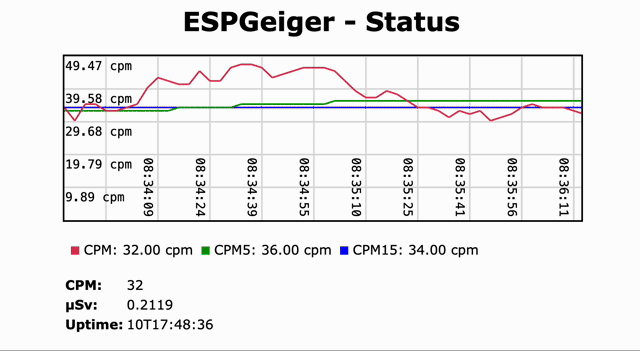

# Web Portal

ESPGeiger comes with a built-in Web Portal that lets you configure your device and view the live readings and status output from your laptop or mobile device.



## Configuring your device

The main page has buttons to reach each area of configuration:

* **Config** - all general device and output settings. See the [Configuration reference](/configuration) for the full list of options, value ranges and defaults.
* **Network Config** - Wi-Fi, static IP, time zone and NTP server. See [/network page](#network-page) and [Time and NTP](/configuration/ntp).
* **HV Config** - high-voltage tuning for ESPGeiger-HW boards. See [HV Configuration](/configuration/hv).

## Live blip indicator on `/status`

The coloured dot next to the CPM reading on the `/status` page is a synchronised mirror of the [NeoPixel output](/output/neopixel) - it flashes at a rate proportional to the CPM-vs-CPM5 ratio and changes colour based on a Poisson z-score against the 5-minute baseline. See the [NeoPixel page](/output/neopixel#how-the-trend-colour-and-flash-rate-are-derived-modes-3-and-4) for the colour table and full derivation.

It's an "activity trend" indicator rather than a per-click visualization. For per-click visual feedback, see the blip LED on supported builds. 

## Console log

The Status page includes a live console tail of the device's log. Timestamps follow two formats:

* `HH:MM:SS` - wall-clock time (device has synced to NTP and applied its configured timezone). The web UI converts these to your browser's local timezone so they line up with the graph.
* `HH:MM:SS*` - uptime since boot. The trailing asterisk signals that NTP hasn't synced yet; the time is not wall-clock and the browser should not timezone-shift it. Once NTP syncs, new lines appear without the asterisk.

In [offline mode](/configuration/offlinemode) there is no wall-clock and no asterisk - timestamps are plain uptime. The web portal itself isn't reachable when WiFi is disabled, but the same format appears on the serial console.

## HTTP endpoints

The ESPGeiger web portal exposes a number of HTTP endpoints that are useful for integration, scripting, or simply linking to directly from a browser.

| Path | Description |
|---|---|
| `/` | Main home page |
| `/status` | Detailed device status page (live readings, uptime, build info) |
| `/hist` | Rolling 24 h click history, lifetime totals and inter pulse interval histogram - see [History page](/output/history) |
| `/clicks` | JSON feed of the 24 h hourly bucket array plus today/yesterday totals and (when enabled) the lifetime block `{clk, fbt, secs}` - powers `/hist`. `secs` = tracked seconds (CPM denominator, advances only over persisted spans); `fbt` = first-boot epoch (install age). |
| `/json` | Machine-readable status snapshot - see [JSON Endpoint](/output/integrations#json-endpoint) |
| `/lastdata` | GeigerLog-compatible CSV line - see [GeigerLog](/output/integrations#geigerlog) |
| `/info` | Human-readable HTML page with full device + network identity - see [/info page](#info-page) |
| `/about` | Build, hardware and module identity, as JSON (useful for support) |
| `/network` | WiFi + static IP + NTP configuration - see [/network page](#network-page) |
| `/outputs` | Whether each enabled upload service is working, as JSON |
| `/hv` | High-voltage tuning page (ESPGeiger-HW builds only) |
| `/cpm?v=N` | Set target CPM on test geiger builds - see [Test build CPM setter](#test-build-cpm-setter) |
| `/screen` | Live display preview (OLED and MAX7219/TM1637 builds) - see [OLED](/output/oled#browser-screen-viewer) |
| `/export` | Streaming base64+CRC32 dump of all prefs (skips `sys.web_pass` and the `net` group). UI lives on the Config page's Backup tab. |
| `/import` (POST) | Apply a previously-exported blob (overlay-only; keys not in the blob are left alone). Reboots on success. |
| `/life/reset` (POST) | Zero the lifetime click counter + first-boot timestamp. Button on `/hist`. |
| `/erase` | Wipe saved WiFi credentials and reboot into the captive setup portal. Linked from `/network` → Erase WiFi config. |
| `/restart` | Reboots the device - use with care |

For the `/json` response schema and examples of integrating `/json` or `/lastdata` with external tools (GeigerLog, Home Assistant, Prometheus, InfluxDB, Node-RED, Grafana), see [Integrations](/output/integrations).

The `/outputs` and `/about` response formats are on the [HTTP endpoint schemas](/dev/http-endpoints) developer page.

### `/info` page

Human-readable HTML report grouped into expandable sections. Useful as the first stop when raising a support issue or debugging odd behaviour.

| Section | Contents |
|---|---|
| System | Uptime, chip ID, platform, flash size, core/SDK version, CPU frequency, free heap, sketch size, last reset reason. On ESP8266, exception cause / PC / address are shown when the last reset was a crash. |
| Network | SSID, BSSID, signal strength, channel, local IP, gateway, subnet, DNS, MAC, hostname. AP mode shows softAP SSID, IP and MAC instead. |
| Firmware | Version, git hash, build environment, build date, geiger model + type, PCNT availability, test-build flag. |
| Modules | List of compiled-in modules and their runtime state. |

For machine-readable equivalents see `/json` (live data) and `/about` (static identity).

### `/network` page

WiFi + IP + NTP configuration, all on a single page. Reachable from the home page or directly via `/network`.

| Setting | Notes |
|---|---|
| **Network** dropdown | Live-scanned list of nearby SSIDs. The **Rescan** button re-runs a fresh scan. |
| **SSID** | Manual SSID entry. Blank keeps the current network (useful when only changing the password or IP settings). |
| **Password** | WPA2 password. Blank for open networks. |
| **Use static IP** | Toggle under **Network (advanced)**. When unchecked the device gets its address by DHCP. When checked the four IP fields below take effect after reboot. |
| **IP address / Gateway / Subnet mask** | IPv4 fields with client-side validation. Server re-validates at boot; invalid combinations fall back to DHCP. |
| **DNS server** | Optional. If blank, the gateway is used. |
| **Time / NTP** | Lazy-loaded section: timezone picker, NTP server, manual time/date entry, DST mode. Pulls a ~4 KB JS payload only when expanded. |
| **Erase WiFi config** | Under **Advanced**. Wipes saved credentials and reboots into the captive setup portal. Useful when no hardware reset button is available. |

After **Save and reboot**, the device tries the new credentials. If the new network is unreachable, the previous one is restored automatically after about a minute.

### Test build CPM setter

Test builds (any target whose `GEIGER_TYPE` has the test bit set, e.g. `espgeigerlog_test`, `esp32_testpulse`, `espgeigerlite_testpulse`) expose `/cpm` so you can steer the simulated counter from a browser or script. This is useful for exercising downstream integrations (MQTT, Thingspeak, alert thresholds, dashboards) without needing a radiation source.

```
GET /cpm?v=<target_cpm>
```

| Parameter | Meaning |
|---|---|
| `v` | Target CPM. Must be a positive integer; values ≤ 0 are ignored. |

The internal test counter retargets to generate pulses at the given rate (Poisson-distributed for pulse-type test builds). Response body is `OK` on success.

Example - set target to 150 CPM:

```
curl http://192.168.1.100/cpm?v=150
```

The endpoint is absent from non-test builds.
